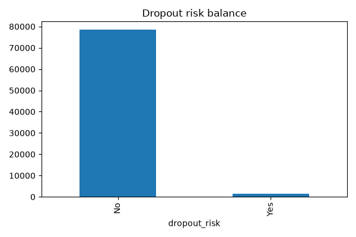
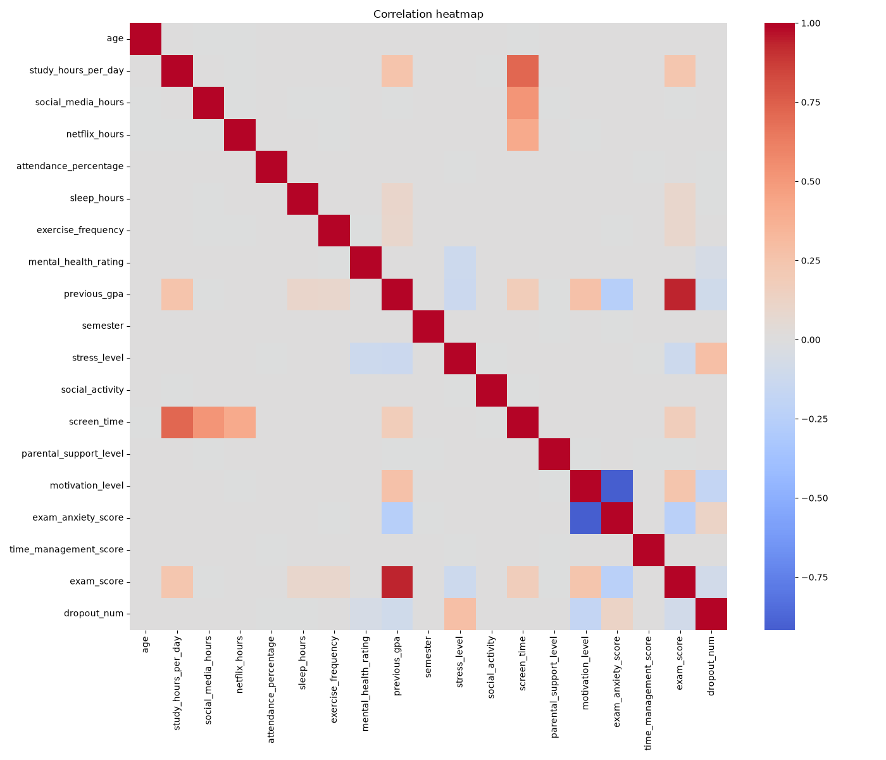
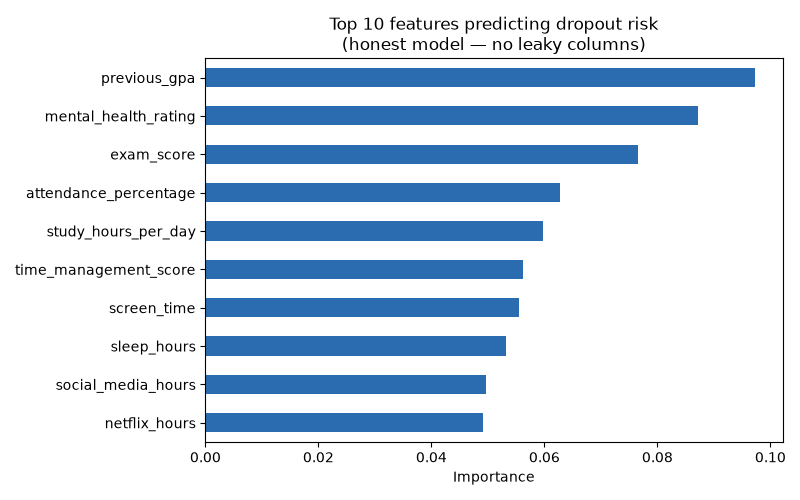

# Zenwi RiskSense

**An ML prototype for identifying at-risk students, built as an R&D feature concept for [Zenwi](https://github.com/Sindhu0012/zenwi), my study-tracker app.**

> **Honest framing:** This uses a public Kaggle dataset, not real Zenwi user data (Zenwi has too few users for meaningful ML). The engineering is real; the data source is public and clearly labeled as such.

## The problem

Can we predict which students are at risk of dropping out from everyday habits (study time, sleep, screen time, attendance) rather than waiting until grades show it?

## Dataset

Enhanced Student Habits & Performance Dataset (Kaggle): 80,000 students, 31 columns (29 features plus `student_id` and the `dropout_risk` Yes/No label). No missing values.

## What I found during EDA



The dataset is heavily imbalanced: only 1,582 of 80,000 students (about 2%) are labeled "Yes". A model can score 98% accuracy by predicting "No" every time while being useless, so I used `class_weight='balanced'` and evaluated with precision, recall, ROC-AUC and PR-AUC instead of accuracy.



## A data leak I caught

With all features, Random Forest scored a perfect 1.0 on every metric. That's a red flag, so I investigated. A depth-3 decision tree exposed this rule:

> `dropout_risk = Yes` exactly when `stress_level > 8` AND `motivation_level <= 3` AND `exam_anxiety_score == 10`

I verified it directly: the rule predicts all 1,582 dropouts with **0 mismatches**. The label is a hard-coded synthetic formula, so the models were rediscovering the dataset's generator, not learning anything about students.

I then removed those three columns and retrained. All conclusions below come from this leak-free setup.

## Models trained

- Logistic Regression (`class_weight='balanced'`)
- Random Forest (`class_weight='balanced_subsample'`, 200 trees)

## Results

| Metric (Yes class) | Logistic Regression | Random Forest |
|---|---|---|
| Precision | 0.03 | 0.00 |
| Recall | 0.56 | 0.00 |
| ROC-AUC | 0.688 | 0.676 |
| PR-AUC | 0.049 | 0.056 |

For reference: a no-skill model has PR-AUC of about 0.02 (the dropout rate) and ROC-AUC of 0.5. Both models are only slightly better than random. Random Forest reached 98% accuracy while catching 0 of 316 dropouts, which is why accuracy is the wrong metric here.

For comparison, with the leaky columns included: Logistic Regression had recall 1.00 and PR-AUC 0.816, and Random Forest scored 1.0 on everything.

## Feature importance (leak-free model)



| Rank | Feature | Importance |
|---|---|---|
| 1 | previous_gpa | 0.097 |
| 2 | mental_health_rating | 0.087 |
| 3 | exam_score | 0.077 |
| 4 | attendance_percentage | 0.063 |
| 5 | study_hours_per_day | 0.060 |

The importances are spread almost evenly (0.05 to 0.10) and the model barely beats random, so I don't read much into this ranking. It mostly shows that once the generating columns are removed, no remaining feature carries a strong signal.

## Takeaways

- Perfect scores usually mean leakage or synthetic labels: investigate before celebrating.
- Use recall, precision and PR-AUC on imbalanced data, not accuracy.
- Shallow decision trees and feature importance are quick ways to expose hidden rules.
- This dataset is not suitable for a real dropout predictor. A real version needs real, noisy student data.

## Why this matters for Zenwi

Zenwi already tracks study habits and time management, so a risk feature is a plausible future direction. This project shows the pipeline and, more importantly, the validation discipline such a feature would need before anyone trusts it.

## Tech stack

Python, pandas, scikit-learn, matplotlib, seaborn

## Project structure

```
zenwi-risksense/
├── 1_eda.py                  # Shape, types, missing values, class balance
├── 2_leak_check.py           # Finds and verifies the hidden label rule
├── 3_train_model.py          # Trains Logistic Regression and Random Forest
├── 4_feature_importance.py   # Feature importance on the leak-free data
├── balance.png               # Class balance chart
├── heatmap.png               # Correlation heatmap
├── feature_importance.png    # Feature importance chart
├── data/students.csv         # Kaggle dataset (not included, download it yourself)
└── README.md
```

## Run it

```bash
python -m venv venv
source venv/bin/activate
pip install pandas scikit-learn matplotlib seaborn
# put the Kaggle CSV at data/students.csv
python 1_eda.py
python 2_leak_check.py
python 3_train_model.py
python 4_feature_importance.py
```cat > README.md << 'EOF'
# Zenwi RiskSense

**An early-warning ML prototype for identifying at-risk students — built as an R&D feature concept for [Zenwi](https://github.com/Sindhu0012/zenwi), my study-tracker app.**

> **Honest framing:** This uses a public Kaggle dataset, not real Zenwi user data (Zenwi currently has too few users for any meaningful ML). This project prototypes the ML approach Zenwi could eventually use if it scales — the engineering here is real, the data source is public and clearly labeled as such.

## The problem

Can we predict which students are at risk of dropping out *before* it happens, using everyday habits — study time, sleep, screen time, attendance — rather than waiting until grades already show it?

## Dataset

[Enhanced Student Habits & Performance Dataset](https://www.kaggle.com) — 80,000 students, 30 features including study hours, sleep, social media/Netflix use, attendance, stress, motivation, and a `dropout_risk` (Yes/No) label.

## What I found during EDA


The dataset is heavily imbalanced — the vast majority of students are labeled "not at risk," with only a small fraction flagged "Yes." This matters a lot: a model can score 95%+ accuracy just by predicting "No" every single time, while being completely useless. This is why I used `class_weight='balanced'` during training and evaluated with precision/recall/ROC-AUC instead of relying on plain accuracy.


## A data-leak I caught and removed

Three columns — `stress_level`, `motivation_level`, and `exam_anxiety_score` — turned out to correlate suspiciously strongly with the `dropout_risk` label. I tested this directly with a simple rule (`stress > 8 AND motivation ≤ 3 AND anxiety = 10`), and it matched the real labels almost perfectly on its own — a strong sign these columns were used to *construct* the synthetic label in the first place, rather than being independent predictors.

**I trained and report two versions**: one including these columns (inflated, unrealistic performance) and one honestly excluding them (the real, trustworthy result). All final conclusions below are from the **honest, leak-free model**.

## Models trained

- Logistic Regression (`class_weight='balanced'`)
- Random Forest (`class_weight='balanced_subsample'`, 200 trees)

## Results (honest model — leaky columns removed)

<!-- Fill these in from your train.py output, the "(WITHOUT stress, motivation, anxiety)" section -->
| Metric | Logistic Regression | Random Forest |
|---|---|---|
| Precision (Yes) | _fill in_ | _fill in_ |
| Recall (Yes) | _fill in_ | _fill in_ |
| ROC-AUC | _fill in_ | _fill in_ |
| PR-AUC | _fill in_ | _fill in_ |

## What actually predicts risk


Top drivers of dropout risk (honest model, no leaked columns):

1. **Previous GPA** (0.097) — past academic performance is the single strongest signal
2. **Mental health rating** (0.087)
3. **Exam score** (0.077)
4. **Attendance percentage** (0.063)
5. **Study hours per day** (0.060)
6. Time management score, screen time, sleep hours, social media hours, Netflix hours — all moderately contribute

## Why this matters for Zenwi

If Zenwi scaled to real users, a feature like this could flag at-risk students early — using exactly the kind of data Zenwi already tracks (study habits, time management) — well before a drop in grades becomes visible.

## Tech stack

Python, pandas, scikit-learn, matplotlib, seaborn

## Project structure
